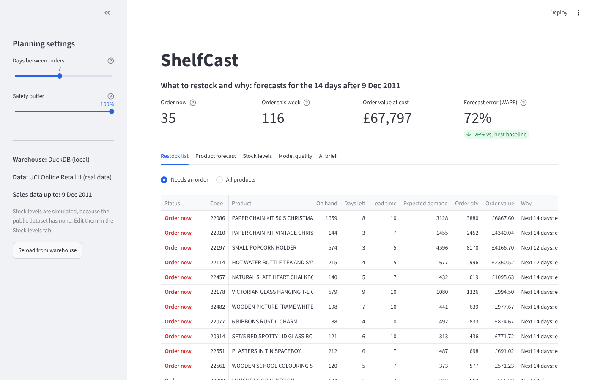
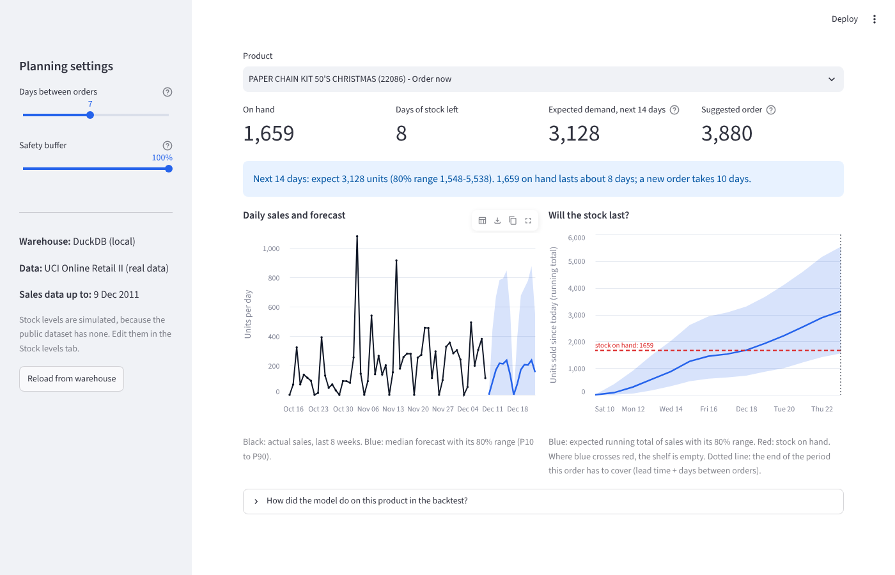
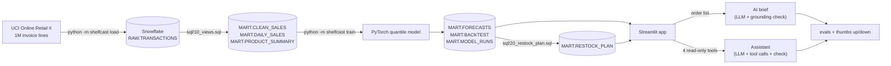

# ShelfCast

[](https://github.com/FarnooshMemari/shelfcast/actions/workflows/tests.yml)

ShelfCast helps a small online shop decide what to restock. Sales data and the business rules live in Snowflake, a PyTorch model forecasts demand for each product, and a Streamlit app turns the forecasts into an order list: what to order today, how much, and why.

Built for [ForgeHacks 2026](https://forgehacks-2026.devpost.com) (AI + Business track).



## The problem

Small online shops often reorder by gut feeling or by looking at last month's average. That goes wrong both ways: best sellers run out, and slow sellers pile up and tie up cash. A forecast alone doesn't solve it. The person placing orders needs to know what to order today, how much, and why.

## What it does

1. Loads two years of real transactions from a UK online gift shop (UCI Online Retail II, 1,067,371 invoice lines) into Snowflake.
2. Cleans them with SQL in Snowflake: cancellations, returns, postage, fees and bulk orders that were cancelled later are removed, then sales are rolled up per product per day.
3. Trains one PyTorch model on the 200 best sellers. For each of the next 14 days it gives a low, expected and high forecast (P10 / P50 / P90), and it does the same for the running total, since that is what an order has to cover.
4. Turns the forecasts into decisions. Each product gets a status (Order now, Order this week, OK), an order quantity, its cost and a one-line reason. The same rules also run as a SQL view in Snowflake (`MART.RESTOCK_PLAN`).
5. Shows it all in a Streamlit app: sliders for the safety buffer and how often orders are placed, editable stock levels, charts for each product and the backtest results.
6. Adds two AI features on top, both kept honest by the same check: a **restock brief** written by a language model and verified number by number against the order list, and an **assistant** that answers questions ("what if lead times go up to 10 days?") by calling four read-only tools over the plan. See [AI brief and assistant](#ai-brief-and-assistant).



## Results on real data

These results come from a full run on Snowflake (a trial account, 5 Oct 2026), started from a Kaggle notebook: 1,067,371 invoice lines loaded into `RAW.TRANSACTIONS`, cleaned with SQL inside Snowflake (1,036,831 clean sales lines, 4,706 products), and the forecasts and restock plan written back to the `MART` tables.

The model was trained without the last 14 days of data (26 Nov to 9 Dec 2011) and then forecast those days for the 200 products. Lower is better.

| Forecast | Daily error (WAPE) | Two-week total error (WAPE) |
|---|---|---|
| **ShelfCast (PyTorch)** | **71.6%** | **41.7%** |
| Same weekday last week | 101.1% | 52.6% |
| 28-day average | 97.1% | 42.0% |

- Daily error is 26% lower than the best simple baseline. For two-week totals the model and the 28-day average are about even (41.7% vs 42.0%).
- The ranges are well calibrated: 80.5% of the real two-week totals fell inside the model's 80% range. Adding up daily ranges instead (a common shortcut) gives a range 81% wider that caught 95% of totals. With the same stock levels, sizing orders that way would have bought 87% more stock (£132k instead of £70k at cost).
- Training takes about a minute on a CPU. Full report: [reports/RESULTS.md](reports/RESULTS.md).

WAPE is total absolute error divided by total units sold. Daily errors are high for every method because single products sell in lumpy wholesale orders (0 units one day, 400 the next), so the comparison with the baselines matters more than the raw number.

## How it works



### Model ([`shelfcast/model.py`](shelfcast/model.py))

- A small MLP (two hidden layers, about 128k parameters) trained on all 200 products at once, so slow sellers can borrow patterns from busy ones.
- Input: the last 56 days of sales divided by their average (so big and small sellers look alike), plus the weekdays of the 14 days being forecast.
- Output: P10 / P50 / P90 for each day and for the running total. The output layer keeps the quantiles in order and non-negative, and the running totals never decrease.
- Loss: quantile (pinball) loss. Early stopping uses the two weeks before the test period, and the final model is retrained on all the data.

### Restock rules ([`shelfcast/restock.py`](shelfcast/restock.py), same logic in [`sql/20_restock_plan.sql`](sql/20_restock_plan.sql))

- An order has to last until the next one arrives: lead time + days between orders.
- Target stock = expected demand for that period + buffer x (high forecast - expected). A 100% buffer plans for the P90, which is roughly a 90% chance of not running out.
- Order quantity = target - stock on hand - stock already on order.
- *Order now* if expected sales empty the shelf before a new order could arrive; *Order this week* if an order is needed but there is still time.

## AI brief and assistant

Both features use any OpenAI-compatible chat API (OpenAI, Groq, Together, OpenRouter, a local Ollama server) through one small stdlib-only client ([`shelfcast/llm.py`](shelfcast/llm.py)). Set three variables in `.env` (or in the app's secrets when deployed) and the two tabs switch on; without them the app shows its built-in summary and the assistant stays off.

```bash
SHELFCAST_LLM_API_KEY=...                 # OPENAI_API_KEY also works
SHELFCAST_LLM_MODEL=gpt-4o-mini           # or llama-3.1-8b-instant, qwen2.5:7b, ...
SHELFCAST_LLM_BASE_URL=https://api.openai.com/v1   # e.g. https://api.groq.com/openai/v1 or http://localhost:11434/v1
SHELFCAST_LLM_REASONING_EFFORT=low   # optional; for models that think first (e.g. Gemini 3) so the answer is not cut off
```

### The brief, with a grounding check ([`shelfcast/brief_ai.py`](shelfcast/brief_ai.py))

The model gets the top rows of the order list (as JSON) and the totals, and writes a short note for the store manager. The note is not shown until it passes four checks against the very same table:

1. every number in the note appears in the table or its totals (rounding to whole units is allowed);
2. no stock code appears that is not in the table;
3. at least one of the three most urgent products is named;
4. it is under 200 words.

A note that fails is sent back once with the list of problems ("numbers not in the order list: 999, 1,500"). If it fails again, the app shows the plain built-in summary and says why. The check is simple on purpose: it cannot judge whether the advice is sensible, only whether the model stayed inside the numbers it was given. That is the failure that matters most for a tool someone orders stock with.

### The assistant ([`shelfcast/assistant.py`](shelfcast/assistant.py))

The assistant never sees the whole warehouse and never writes SQL. It can call four functions over the tables already on the page, all read-only:

| Tool | What it returns |
|---|---|
| `get_restock_plan(status, top)` | The current order list under the current settings |
| `get_product(product)` | One product's plan row, its 7- and 14-day forecast range and its last 28 days of sales |
| `what_if(review_days, buffer_pct, lead_time_days, product)` | The order list after re-running the restock rules with other settings, and the change for one product |
| `search_products(query)` | Products whose name matches, with status and order quantity |

Every tool call and its result are shown under the answer ("What the assistant looked up"), and the answer goes through the same number check against those results. An answer with a number the tools never returned gets one correction round; if it still doesn't match, it is shown with a warning rather than hidden, because the tool results are right there to compare against. Off-topic questions are declined by the system prompt.

### Evaluation ([`shelfcast/evals.py`](shelfcast/evals.py))

`evals/brief_cases.json` holds 15 order lists: the real run under six planning settings, each shown with 3 and with 8 rows, plus three hand-made edge cases (one product, nothing to order, very large numbers). `python -m shelfcast evals --models a,b` has each model write a brief for every case, scores all of them with the grounding check and writes `reports/brief_evals.md`: grounded on the first try, grounded after one retry, how often the app would have fallen back to the template, average length and seconds. The built-in template is scored too, as a baseline that must always be 100%; if it ever isn't, the check is broken, not the model.

To run it: `python -m shelfcast evals --models gpt-4o-mini,llama-3.1-8b-instant` (the models must be reachable through the configured API). Rebuild the cases from your own run with `--make-cases`.

### Feedback

Each brief and each assistant answer has a thumbs up / down. Ratings go to `data/feedback.jsonl` (never committed), and `python -m shelfcast feedback` prints the share rated up per feature and model, next to how many of those answers passed the check. That is the number that decides whether the AI features earn their place.

## Quick start (no accounts needed)

```bash
git clone https://github.com/FarnooshMemari/shelfcast.git
cd shelfcast
python -m venv .venv && source .venv/bin/activate      # Windows: .venv\Scripts\activate
pip install -r requirements.txt
streamlit run app/streamlit_app.py
```

The app starts with a saved snapshot of the Snowflake run (the `demo/` folder). To run the whole pipeline on a local DuckDB file:

```bash
python -m shelfcast all              # real data: 45 MB download, reading the Excel file takes a few minutes
python -m shelfcast all --synthetic  # or synthetic data, about 20 seconds
```

If the download fails, get `online_retail_II.xlsx` from the [UCI page](https://archive.ics.uci.edu/dataset/502/online+retail+ii) and run `python -m shelfcast all --excel path/to/online_retail_II.xlsx`.

On Linux, `pip install torch --index-url https://download.pytorch.org/whl/cpu` before installing the requirements gives a much smaller PyTorch download.

## Running on Snowflake

The SQL runs unchanged on Snowflake and DuckDB, so switching only needs credentials.

1. Create a free trial account at [signup.snowflake.com](https://signup.snowflake.com).
2. In Snowsight, open a SQL worksheet, paste [`sql/00_snowflake_setup.sql`](sql/00_snowflake_setup.sql), replace `YOUR_USER_NAME` and run all. It creates an X-Small warehouse that suspends after 60 idle seconds, a database, a project role and a programmatic access token (PAT).
3. Copy `.env.example` to `.env` and fill in `SNOWFLAKE_ACCOUNT`, `SNOWFLAKE_USER` and `SNOWFLAKE_PAT`. `SNOWFLAKE_USER` is your login name: if you sign in to Snowflake with a Microsoft or Google account, that is usually your email address.
4. Check the connection, run the pipeline and start the app:

```bash
python -m shelfcast check     # Connected to Snowflake as ...
python -m shelfcast all       # load 1M rows, run the SQL, train, write the forecasts back
streamlit run app/streamlit_app.py
```

The sidebar then shows Snowflake as the warehouse. When no `SHELFCAST_LLM_API_KEY` is set, the AI brief tab can ask Snowflake Cortex to write the restock note instead (`python -m shelfcast brief --cortex`); Cortex's `AI_COMPLETE` isn't available on Snowflake trial accounts, and there the app shows its built-in summary. The plan can also be queried directly in Snowsight:

```sql
SELECT * FROM SHELFCAST.MART.RESTOCK_PLAN ORDER BY order_value DESC;
```

## Deploying the app

On [Streamlit Community Cloud](https://share.streamlit.io), create an app from this repo with `app/streamlit_app.py` as the main file. It installs the lighter `app/requirements.txt` (viewing results doesn't need PyTorch). To read live from Snowflake, add these under Advanced settings > Secrets:

```toml
SNOWFLAKE_ACCOUNT = "ORGNAME-ACCOUNTNAME"
SNOWFLAKE_USER = "YOUR_USER_NAME"
SNOWFLAKE_PAT = "paste-the-token-here"
SNOWFLAKE_ROLE = "SHELFCAST_ROLE"
```

Add `SHELFCAST_LLM_API_KEY`, `SHELFCAST_LLM_MODEL` and (if not OpenAI) `SHELFCAST_LLM_BASE_URL` in the same place to turn on the AI brief and the assistant. Without secrets, or if Snowflake can't be reached, the app shows the saved snapshot from `demo/`.

## Commands

| Command | What it does |
|---|---|
| `python -m shelfcast data` | Download the real data (`--synthetic` makes synthetic data instead) |
| `python -m shelfcast load` | Load the transactions and run `sql/10_views.sql` |
| `python -m shelfcast train` | Backtest, train, forecast, write the restock plan and `reports/RESULTS.md` |
| `python -m shelfcast all` | The three steps above |
| `python -m shelfcast brief` | Print the restock brief (`--ai` has the configured model write and check it; `--cortex` uses Snowflake Cortex) |
| `python -m shelfcast ask "..."` | Ask the restock assistant a question from the terminal |
| `python -m shelfcast evals` | Score the AI brief on the saved order lists (`--models a,b` to compare models; `--make-cases` to rebuild them) |
| `python -m shelfcast feedback` | Summarise the thumbs up / down given in the app |
| `python -m shelfcast snapshot` | Save the tables the app needs to `demo/` |
| `python -m shelfcast check` | Test the warehouse connection |

Add `--backend snowflake` or `--backend duckdb` before the command to pick one. The default is Snowflake when `SNOWFLAKE_ACCOUNT` is set and a local DuckDB file otherwise.

## Project layout

```
app/streamlit_app.py       web app
shelfcast/
    db.py                  one small interface for Snowflake and DuckDB
    data.py                download, synthetic data, daily sales matrix
    model.py               PyTorch quantile model and loss
    forecast.py            backtest against baselines, final training
    restock.py             order rules, built-in brief, Snowflake Cortex
    pipeline.py            load, train, reports, snapshot
    llm.py                 client for any OpenAI-compatible chat API (+ a fake for tests)
    brief_ai.py            AI brief and the grounding check
    assistant.py           the assistant: four read-only tools and the tool-calling loop
    evals.py               eval cases, scoring and the report
    feedback.py            thumbs up / down log
sql/
    00_snowflake_setup.sql
    10_views.sql           cleaning and daily sales (Snowflake and DuckDB)
    20_restock_plan.sql    restock plan as a view
demo/                      snapshot of the real run, used by the app
evals/brief_cases.json     the order lists the AI brief is scored on
reports/RESULTS.md         backtest results, written by `train`
reports/brief_evals.md     AI brief scores, written by `evals`
docs/                      screenshots
tests/
```

## Tests

```bash
pytest
```

The tests check that training windows never include future days, that forecasts are ordered and non-negative, the restock rules on small hand-made cases, the SQL cleaning, that the SQL plan matches the Python plan, the app (with Streamlit's AppTest) and the full command line on synthetic data. The AI parts are tested without any network call: a scripted fake model stands in for the API (a careful one, a sloppy one that invents numbers, and one that loops on tool calls), the HTTP client is tested against a tiny local server, and the grounding check has its own cases. They run in about 20 seconds.

## Limitations

- Stock levels are simulated. The public data has sales but no inventory, lead times or costs, so these are generated per product. They can be edited in the app or replaced with a real `MART.INVENTORY` table.
- "Today" is 9 Dec 2011, the last day in the data.
- The backtest is a single 14-day window in the busiest season of the year. A rolling backtest over many windows would be a stronger test.
- The safety buffer slider moves linearly between the P50 and P90 forecasts, so values in between are only approximate service levels.
- The grounding check verifies that the AI's numbers come from the data, not that its reasoning is right. A brief can pass while recommending the wrong product; that is what the thumbs and the evals are for.
- The assistant keeps the last turns of the conversation as plain text, so a long chat slowly loses detail, and each answer is limited to four rounds of tool calls.

## Next steps

- Run the evals on two or three models and keep the one with the best grounded rate per pound.
- Rolling backtests, plus holiday and price features.
- Train inside Snowflake (Snowpark Container Services) and refresh the plan on a schedule with Snowflake Tasks.
- Connect a real inventory feed and round orders to supplier pack sizes.

## Data and license

Data: Chen, D. (2012). Online Retail II [Dataset]. UCI Machine Learning Repository. https://doi.org/10.24432/C5CG6D, licensed under [CC BY 4.0](https://creativecommons.org/licenses/by/4.0/). The raw data is downloaded when the pipeline runs and is not stored in this repo; `demo/` holds aggregated results derived from it.

Code: [MIT License](LICENSE), Farnoosh Memari, 2026.
